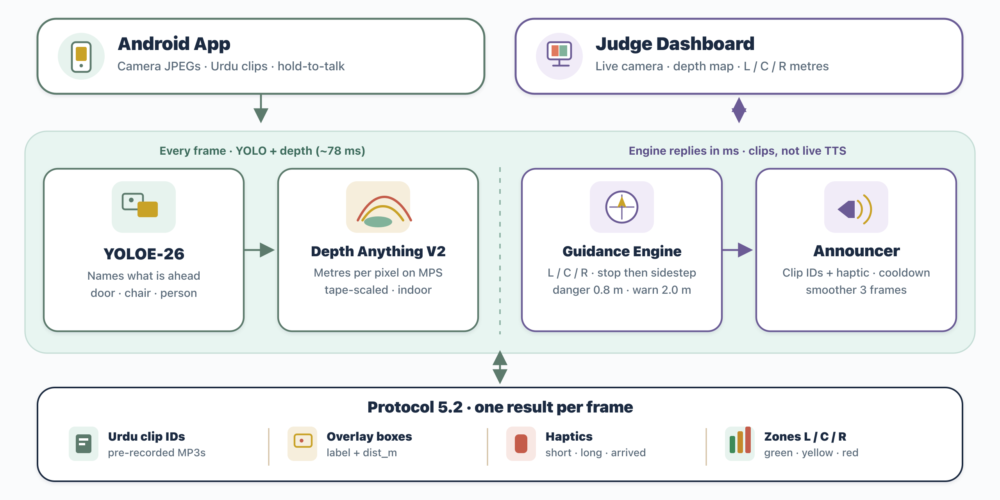
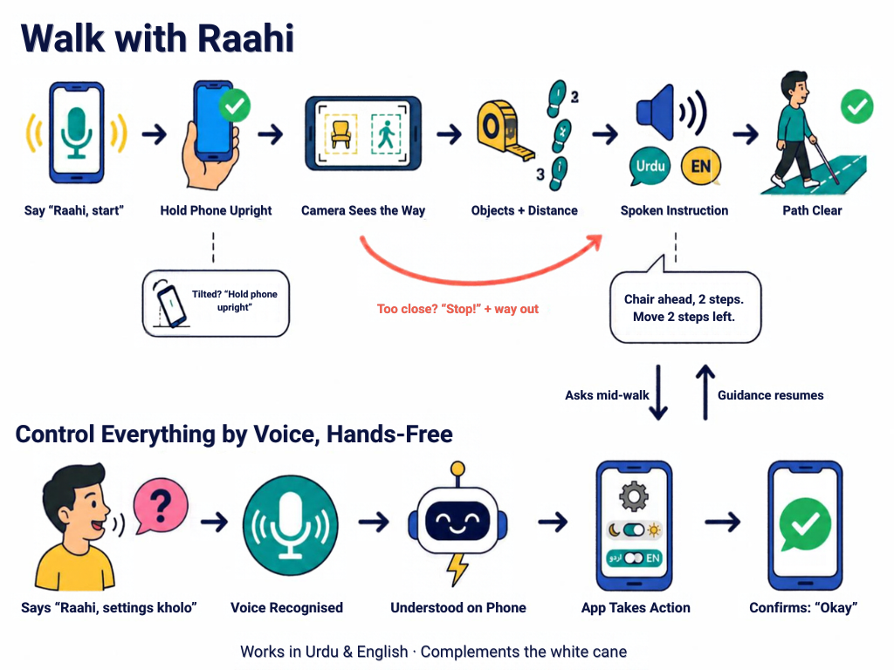

<div align="center">

# Raahi · راہی

**Real-time indoor navigation for visually impaired people, in Urdu and English.**

*A phone camera sees the way. Raahi speaks it.*

Team **Tech Titans** · National University of Sciences and Technology (NUST), Islamabad

</div>

---

## About this repository

This repository holds the supporting material for Raahi's entry to the **4th AIEF International AI Championship** (track: *AI in Healthcare*).

| Folder | Contents |
|---|---|
| [`proposal/`](proposal/) | Project proposal ([Markdown](proposal/Raahi_Proposal.md) and [PDF](proposal/Raahi_Proposal.pdf)) |
| [`diagrams/`](diagrams/) | [System architecture](diagrams/system-architecture.png) and [user flow](diagrams/user-flow.png) |
| [`presentation/`](presentation/) | [Pitch deck](presentation/Raahi-Presentation.pptx) |

The application source code (Android app and AI server) is kept in a separate repository and is available to the judges on request. The working prototype will be demonstrated live at the event.

## Overview

A white cane senses about a metre ahead at ground level, and GPS apps stop working at the door. Indoors (universities, hospitals, offices) a visually impaired person still has to guess where the chair, the open door or the person in the corridor is.

Raahi turns an Android phone into a guide. The phone streams its camera to the Raahi server. The server **recognises objects**, **measures how far away they are**, decides the safest way forward and replies with short spoken instructions in a natural female voice, in **Urdu or English**:

> *"کرسی سامنے ہے، دو قدم پر۔ دو قدم بائیں ہٹیں۔"*
> *"Chair ahead, two steps away. Move two steps left."*

The whole app can be used without looking at the screen. Say **"Raahi"** followed by a command, in Urdu, Roman Urdu or English, to open any screen, change a setting or control guidance.

Raahi works alongside the white cane. It does not replace it.

## Key features

| | Feature | What it does |
|---|---|---|
| 🦯 | **Obstacle guidance** | Continuous warnings with the object's name, its distance in steps and which way to step to avoid it. Obstacles without a name (walls, boxes) are caught by depth estimation. |
| 🛑 | **Danger stop** | Anything within about 0.8 m triggers an immediate spoken "Stop!", always followed by a way out (step left, right or back), plus a long vibration. |
| 🗣️ | **Bilingual voice** | Every instruction is recorded in Urdu and English (ElevenLabs Eleven v3, one consistent female voice), so playback starts instantly with no text-to-speech delay. The language can be switched at any time. |
| 🎙️ | **Full voice control** | "Raahi, settings kholo", "Raahi, dark mode", "Raahi, start detecting", "Raahi, English mein bolo". Speech is recognised by ElevenLabs Scribe v2 Realtime and matched **on the phone**, with no server round trip, so commands act as soon as they are heard. Works hands-free or with a long-press. |
| 🔎 | **What's ahead?** | A one-time spoken description of the nearest objects, with direction and distance. |
| 🚪 | **Find mode** | Guides the user to a door, chair, table, sofa, bin or person: turn left or right, steps remaining, then "you have reached the door". |
| 📱 | **Accessible by design** | TalkBack labels on every control, high-contrast theme, adjustable text size, large controls, haptic patterns, light and dark themes, and a prompt to hold the phone upright when it is tilted. |
| 🖥️ | **Judge dashboard** | Live camera with detection boxes, colour depth map, left / centre / right distances, the sentence being spoken and the time taken by each stage. |
| 🔒 | **Privacy** | No accounts. History is stored on the phone only. The ElevenLabs API key never leaves the server; the phone uses single-use tokens. |

## System architecture



Each camera frame goes through object detection and depth estimation, then the guidance engine and the announcer. The server returns one result per frame: voice clip IDs, overlay boxes, a haptic pattern and the left / centre / right zone distances. The judge dashboard shows the live camera, the depth map and those distances.

## User flow



**Walk with Raahi.** The user says "Raahi, start" and holds the phone upright. The camera names what is ahead and how far away it is, and a spoken instruction in Urdu or English says how to step around it. If something is too close, Raahi says "Stop!" and then gives the way out. When the path is clear, Raahi says so. If the user asks a question while walking, guidance pauses and then resumes.

**Control everything by voice.** "Raahi, settings kholo" is recognised and understood on the phone. The app acts (theme, language, navigation) and confirms with "Okay".

## How it works

```
 Android phone                                  Raahi server (FastAPI)
 ─────────────                                  ─────────────────────
 CameraX frame (upright, 416 px JPEG) ───WS───▶ YOLOE-26 object detection ─┐
                                                Depth Anything V2 (metres) ─┤
                                                                            ▼
                                                Guidance engine
                                                  · left / centre / right zones
                                                  · nearest obstacle, distance in steps
                                                  · safest side + steps to move
                                                  · find / describe modes
                                                  · smoother + announcer (no repeats,
                                                    stop once, then the way out)
 Plays prerecorded clips (Urdu / English) ◀──WS── clip ids: ["obj_chair","pos_ahead",
 vibrates on danger                               "steps_2","move_left_2"]
 Mic ─▶ ElevenLabs Scribe ─▶ on-device command matcher ─▶ navigation / settings / guidance
```

**Why prerecorded clips?** Guidance has to stay in step with what the camera sees. Live text-to-speech adds hundreds of milliseconds and needs the network. Raahi builds sentences from about 100 short recorded phrases per language (object, position, distance, action), so audio starts as soon as a decision is made. A cached live text-to-speech fallback covers rare labels.

**Why combine depth with object size?** Monocular depth estimation works well at room scale but is unreliable very close to the camera. Raahi combines the depth map with each detected object's known real-world size (its height, or its width when the frame cuts it off) and keeps the closer estimate. This way a person standing right in front of the camera is never reported as "path clear".

## Tech stack

| Layer | Technology |
|---|---|
| Object detection | Ultralytics **YOLOE-26** (open-vocabulary), 28 indoor classes, exported to ONNX / LiteRT (TFLite) / CoreML |
| Depth | **Depth Anything V2** Metric Indoor Small (Hugging Face Transformers; PyTorch MPS / CPU, CoreML fallback) |
| Server | Python, **FastAPI**, WebSockets, OpenCV, NumPy |
| Voice | **ElevenLabs** Eleven v3 (Urdu and English clips), **Scribe v2 Realtime** (speech-to-text), live text-to-speech fallback |
| Android | **Kotlin**, **Jetpack Compose**, CameraX, OkHttp WebSockets, DataStore, kotlinx.serialization |
| Training | Kaggle / Colab notebooks: model export, plus optional fine-tuning on COCO, Open Images and venue photos |

## Voice commands

Start with **"Raahi"** (hands-free), or long-press anywhere on the screen (no wake word needed).

| Say (Urdu / Roman Urdu / English) | Action |
|---|---|
| "سیٹنگز کھولو" · "settings kholo" · "go to settings" | Open Settings (also accessibility, voice settings, history, help, privacy, about) |
| "واپس جاؤ" · "go back" · "go home" | Go back / go home |
| "ڈارک موڈ" · "dark mode" · "light mode" | Change theme (also high contrast, bigger or smaller text) |
| "انگلش میں بولو" · "switch to Urdu" | Change the guidance language |
| "آواز تیز کرو" · "louder" · "speak slower" | Volume and speech speed |
| "شروع کرو" · "start detecting" | Start guidance |
| "رک جاؤ" · "pause" · "jari rakho" · "band karo" | Pause / resume / stop guidance |
| "سامنے کیا ہے" · "what's ahead?" | Describe the surroundings |
| "دوبارہ بولو" · "repeat" | Repeat the last instruction |

All commands live in a single vocabulary file, so new phrases can be added without changing code.

## Team

| Member | Role | Contribution |
|---|---|---|
| **Esha Shabbir** | Detection & Voice AI | YOLOE-26 object detection (class design, export to ONNX / TFLite / CoreML, training notebooks); the Urdu and English voice system (ElevenLabs clip library, batch recording pipeline, sentence assembly); Scribe speech recognition; the bilingual voice-command and voice-navigation engine; live text-to-speech fallback; guidance tuning and the laptop demo |
| **Uswa Khan** | Depth & Judge Dashboard | Depth Anything V2 metric depth (MPS / CoreML, calibration); depth-based navigation zones and the server; the live judge dashboard with detections, depth map, zones and timings |
| **Abeera Amir** | Mobile App & Frontend | The native Android app end to end: all screens and flows (onboarding, guidance, find, what's ahead, history, settings, accessibility, diagnostics, errors), the design system, camera streaming, audio playback, haptics and accessibility |

## Roadmap

- Fully on-device mode (the detector already exports to LiteRT / TFLite)
- Stairs and drop-off detection
- Outdoor navigation
- More languages (Punjabi, Pashto, Sindhi)
- Partnerships with schools and organisations for visually impaired people

---

<div align="center">

**Raahi · راہی**: seeing the way, together.

</div>
